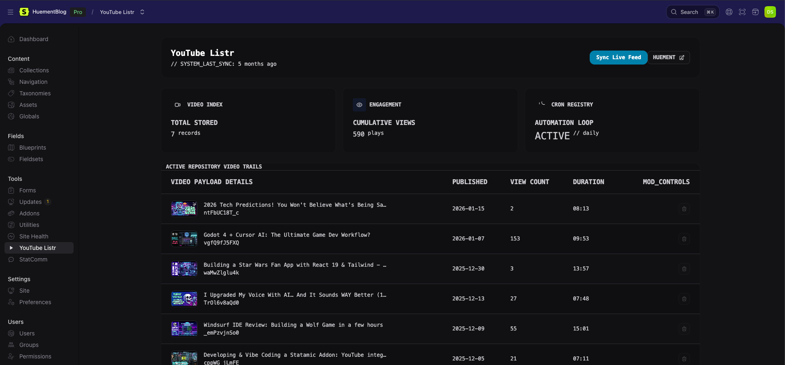
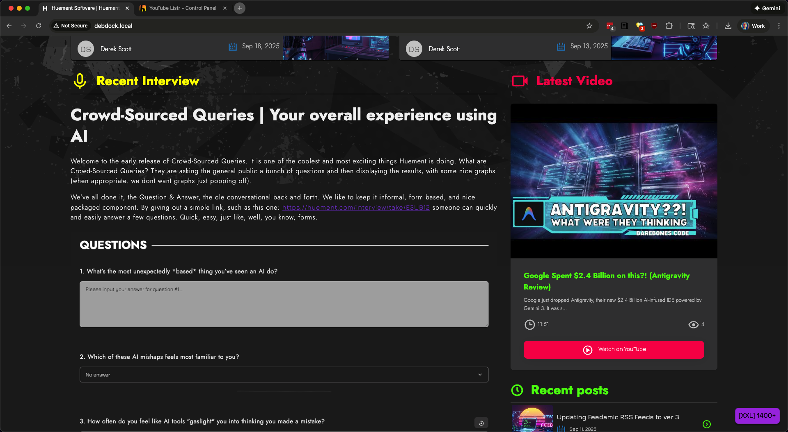

# Statamic YouTube Listr

A Statamic addon that syncs YouTube videos from a channel to your local database and provides Antlers tags to display them.


_Manage your YouTube videos directly from the Statamic Control Panel_

## Features

- 🎥 Sync YouTube videos from any channel
- 📊 View video stats (views, likes, duration)
- 🏷️ Easy-to-use Antlers tags for frontend display
- 🔄 Manual or automated syncing
- 💾 Local database storage for fast access
- 🎨 Clean Control Panel interface

## Installation

You can install the package via Composer:

```bash
composer require huement/statamic-ytlistr
```

The package will automatically register itself with Statamic.

### Requirements

- PHP ^8.1
- Statamic CMS ^5.0 || ^6.0

## Configuration

Add these variables to your `.env` file:

```env
YOUTUBE_API_KEY=your_youtube_api_key
YOUTUBE_CHANNEL_ID=your_youtube_channel_id
YOUTUBE_MAX_RESULTS=50
```

## Usage

### Sync Videos

Via Control Panel:

- Navigate to Tools > YouTube Listr
- Click "Sync Videos from YouTube"

Via Command Line:

```bash
php artisan ytlistr:fetch
php artisan ytlistr:fetch --limit=100
```

## Template Usage

Statamic YouTube Listr is entirely template-engine and storage-driver agnostic. Whether your frontend is powered by **Antlers** or **Blade**, and whether your backend uses the **Database** or **Flat-File (YAML)** driver, your data maps will render perfectly.

### 1. Antlers Templates


_Display your YouTube videos beautifully on the frontend_

List and filter recent videos:

```php
{{ yt_listr limit="5" }}
    <h3>{{ title }}</h3>
    
    <p>{{ duration_formatted }} | {{ view_count }} views</p>
    <a href="{{ youtube_url }}">Watch on YouTube</a>
{{ /yt_listr }}
```

#### Get the Single Latest Video

```php
{{ yt_listr:latest }}
    <h2>{{ title }}</h2>
    <iframe src="{{ embed_url }}" frameborder="0" allowfullscreen></iframe>
{{ /yt_listr:latest }}
```

#### Get total video count:

```php
Total videos: {{ yt_listr:count }}
```

### 2. Laravel Blade Templates

If you are building your frontend templates using standard Laravel Blade, you have two ways to fetch and loop through your video entries safely.

Approach A: Statamic Blade Components (Cleanest)
Statamic registers an engine-level <s:tag> layout scheme that perfectly mirrors standard Antlers markup. It hooks up scopes and isolates variables automatically:

```html
<s:yt_listr:latest>
    <h2>{{ $title }}</h2>
    <p>{{ $duration_formatted }}</p>
    <iframe src="{{ $embed_url }}" frameborder="0" allowfullscreen></iframe>
</s:yt_listr:latest>
```

#### Approach B: Direct Service Container Binding

If you prefer extracting data arrays straight into traditional Blade inline variables, resolve the contract binding from the container.

**Crucial Optimization**: **ALWAYS** route parameters through Laravel's native `data_get()` wrapper. This guarantees that your loop evaluates keys correctly whether the active driver outputs a typed Database Eloquent Model Object or a raw flat-file YAML Data Array. If you dont do this, it will break your loops.

```php
@php
    // Dynamically resolves DatabaseVideoRepository or YamlVideoRepository based on config
    $repo = app(\Huement\StatamicYtListr\Repositories\VideoRepository::class);
    $videos = $repo->recent(6); // Fetch the 6 most recent tracking records
@endphp

@foreach ($videos as $video)
    <a href="{{ data_get($video, 'youtube_url') }}" target="_blank" rel="noopener">
        

        <h3>{{ data_get($video, 'title') }}</h3>

        <div>
            <span>Duration: {{ gmdate('i:s', (int) data_get($video, 'duration', 0)) }}</span>
            <span>Views: {{ number_format((int) data_get($video, 'view_count', 0)) }}</span>
        </div>
    </a>
@endforeach
```

## Available Data

Each video provides:

- `id` - Database ID
- `video_id` - YouTube video ID
- `title` - Video title
- `description` - Video description
- `thumbnail_url` - Thumbnail image URL
- `published_at` - Publication date
- `duration` - Duration in seconds
- `duration_formatted` - Human-readable duration (MM:SS)
- `view_count` - Number of views
- `like_count` - Number of likes
- `comment_count` - Number of comments
- `channel_id` - YouTube channel ID
- `channel_title` - Channel name
- `youtube_url` - Full YouTube URL
- `embed_url` - YouTube embed URL

## Credits

Created and sponsored by [Huement.com](https://huement.com) - A software studio creating awesome content and exceptional web experiences.

## Links

- [GitHub Repository](https://github.com/huement/statamic-ytlistr)
- [Packagist](https://packagist.org/packages/huement/statamic-ytlistr)
- [Huement.com Demo](https://huement.com/blog)

#### Have you seen my comments plugin?

I have a new Statamic 6+ Comments Plugin, called `StatComm`. It's pretty great! Check it out!

- [StatComm Packagist](https://packagist.org/packages/huement/statcomm)
- [StatComm GitHub Repository](https://github.com/huement/statcomm)

### License & Sponsorship

Distributed freely under the open-source **MIT License**. Maintained, optimized, and engineered / sponsored by **[HUEMENT](https://huement.com/)**.

<p align="center">
  <strong>If this software saved you time or a headache, consider keeping the engine running!</strong><br><br>
  <a href='https://ko-fi.com/U1A7222617' target='_blank'>
    
  </a>
</p>
